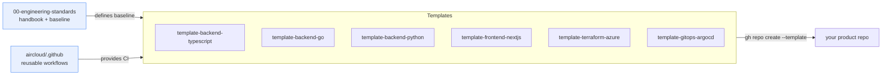

# Template Catalog

The index of all aircloud golden-path template repositories. Each row links to a template
repository you can create new repos from via GitHub's _"Use this template"_ button or
`gh repo create aircloud/<name> --template aircloud/<template>`.

> Org `aircloud`, registry `ghcr.io/aircloud`, and Azure prefix `aircloud` are example
> placeholders — replace them when adopting these standards.

## Templates

| Template | Stack | Use it for | Golden path |
| --- | --- | --- | --- |
| [`aircloud/template-backend-typescript`](https://github.com/aircloud/template-backend-typescript) | Node 22 LTS, TypeScript, Fastify, Vitest, pnpm | HTTP/gRPC services, BFFs, workers | [Backend](./docs/GOLDEN-PATHS.md#backend) |
| [`aircloud/template-backend-go`](https://github.com/aircloud/template-backend-go) | Go 1.23, chi, testify, golangci-lint | High-throughput services, CLIs, controllers | [Backend](./docs/GOLDEN-PATHS.md#backend) |
| [`aircloud/template-backend-python`](https://github.com/aircloud/template-backend-python) | Python 3.12, FastAPI, uv, ruff, pytest | APIs, data/ML serving, glue services | [Backend](./docs/GOLDEN-PATHS.md#backend) |
| [`aircloud/template-frontend-nextjs`](https://github.com/aircloud/template-frontend-nextjs) | Next.js 15, React 19, TypeScript, Playwright | Web apps, dashboards, marketing sites | [Frontend](./docs/GOLDEN-PATHS.md#frontend) |
| [`aircloud/template-terraform-azure`](https://github.com/aircloud/template-terraform-azure) | Terraform 1.9, Azure, OIDC, tflint, checkov | Cloud infrastructure on Azure | [IaC](./docs/GOLDEN-PATHS.md#infrastructure-as-code-iac) |
| [`aircloud/template-gitops-argocd`](https://github.com/aircloud/template-gitops-argocd) | Argo CD, Kustomize, Helm, Kyverno | Kubernetes app delivery (GitOps) | [GitOps](./docs/GOLDEN-PATHS.md#gitops) |

## Shared org repositories

| Repo | Purpose |
| --- | --- |
| [`aircloud/.github`](https://github.com/aircloud/.github) | Org-default community health files and **reusable workflows** consumed via `uses: aircloud/.github/.github/workflows/<name>.yml@<sha>`. |
| [`aircloud/00-engineering-standards`](https://github.com/aircloud/00-engineering-standards) | **This repo** — the engineering handbook. |

## How templates relate to this repo

Each template MUST satisfy [`docs/SECURITY-BASELINE.md`](./docs/SECURITY-BASELINE.md) and
ship the AI-assistant files described in [`docs/AI-ASSISTANTS.md`](./docs/AI-ASSISTANTS.md).
