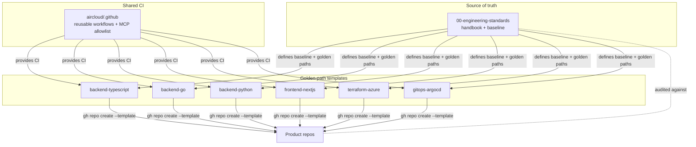
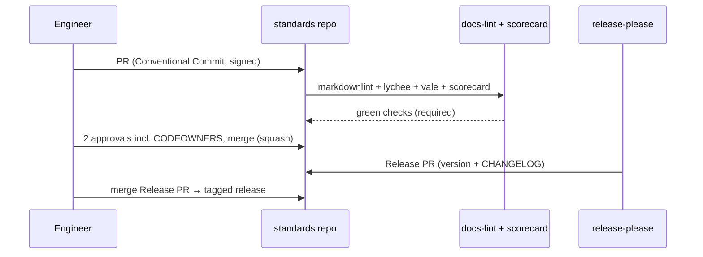

# Architecture

This repository is **documentation + shared configuration**, not a runnable service. Its
"architecture" is the structure of the handbook and how it relates to the rest of the org.

> Org `aircloud`, registry `ghcr.io/aircloud`, Azure prefix `aircloud` are example placeholders.

## Repository structure

```
00-engineering-standards/
├── README.md                     # Entry point: what this is + how to use golden paths
├── CATALOG.md                    # Index of all template repos
├── CONTRIBUTING.md               # How to propose changes
├── SECURITY.md                   # Private reporting + SLA
├── CODE_OF_CONDUCT.md
├── LICENSE                       # Apache-2.0
├── CODEOWNERS
├── CLAUDE.md / AGENTS.md         # AI assistant config (this is a docs repo)
├── .github/
│   ├── copilot-instructions.md
│   ├── workflows/
│   │   ├── docs-lint.yml         # markdownlint + lychee link check + vale
│   │   └── scorecard.yml         # OpenSSF Scorecard
│   ├── ISSUE_TEMPLATE/{bug,feature,config}
│   └── PULL_REQUEST_TEMPLATE.md
├── .cursor/rules/00-project.mdc
└── docs/
    ├── GOLDEN-PATHS.md
    ├── SECURITY-BASELINE.md
    ├── AI-ASSISTANTS.md
    ├── BRANCHING-AND-RELEASE.md
    ├── BRANCH-PROTECTION.md
    ├── THREAT-MODEL-TEMPLATE.md
    ├── OBSERVABILITY.md
    ├── INCIDENT-RESPONSE.md
    ├── CODE-REVIEW.md
    ├── DEFINITION-OF-DONE.md
    └── ARCHITECTURE.md           # this file
```

## How it fits the org



## Content lifecycle



## Design decisions

- **Docs-as-code.** The handbook lives in Git, is reviewed like code, and is versioned with
  `release-please`. Changes are auditable.
- **One baseline, many templates.** The security baseline is defined once here and inherited by
  every template, so we change a control in one place.
- **Tool-neutral AI guidance.** `AGENTS.md` is canonical; per-vendor files point to it (see
  [`AI-ASSISTANTS.md`](./AI-ASSISTANTS.md)).
- **Self-applying.** This repo eats its own dog food: SHA-pinned actions, least-privilege
  workflows, harden-runner, Scorecard, signed commits, and a Ruleset.

---

## Runbook: publish a change to the handbook

**Goal:** safely update guidance and cut a versioned release.

1. **Branch** off `main`: `git switch -c docs/<topic>`.
2. **Edit** the relevant file under `docs/` (or a root governance file). Keep lines wrapped,
   tables valid, and links relative.
3. **Lint locally:**
   ```bash
   make lint      # markdownlint + vale (or: npx markdownlint-cli2 "**/*.md")
   make linkcheck # lychee link check (if installed)
   ```
4. **Commit** with a Conventional Commit, signed:
   `git commit -S -m "docs: clarify cosign keyless signing in security baseline"`.
5. **Open a PR.** CI runs `docs-lint` and `scorecard` (required checks).
6. **Get 2 approvals** including a CODEOWNER (`@aircloud/platform` or `@aircloud/security` for
   baseline changes).
7. **Squash-merge.** `release-please` opens/updates a Release PR.
8. **Merge the Release PR** to tag a new version and update `CHANGELOG.md`.
9. **Announce** material baseline changes in `#engineering`.

## Runbook: roll out a new mandatory control org-wide

1. Draft the control in [`SECURITY-BASELINE.md`](./SECURITY-BASELINE.md) with framework
   mappings and an enforcement plan; get `@aircloud/security` sign-off.
2. Add/extend the reusable workflow in `aircloud/.github`.
3. Update every golden-path template to consume it.
4. Set a **grace period** (e.g. 30 days) tracked via `security-waiver` issues for laggards.
5. Add the check to the standard **required status checks** and to the Scorecard/audit so drift
   is detected automatically.
