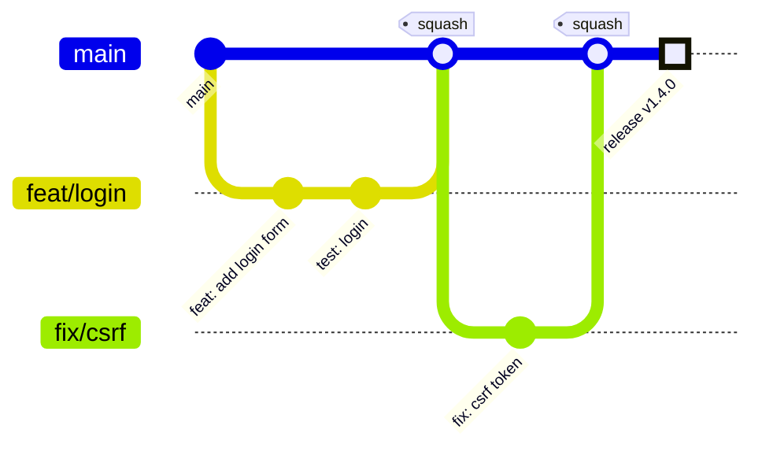
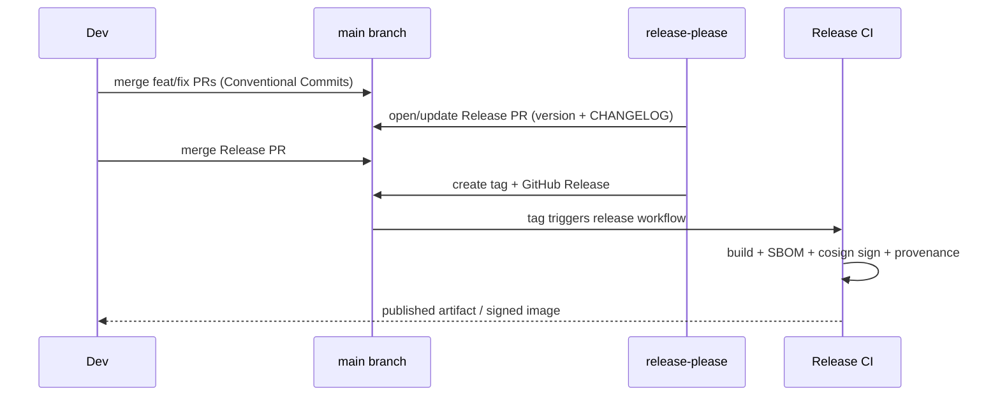
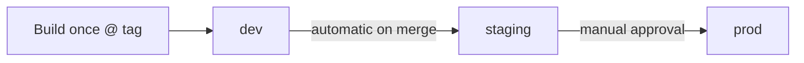

# Branching & Release

aircloud practices **trunk-based development** with short-lived branches, Conventional Commits,
SemVer, and automated releases via `release-please`. This page is the canonical process.

> Org `aircloud` is an example placeholder.

## Trunk-based development

- **`main` is always releasable.** Every merge to `main` keeps it green and deployable.
- **Short-lived branches.** Branch off `main`, finish within ~1–2 days, merge, delete. Long
  feature branches are an anti-pattern; use feature flags to merge incomplete work safely.
- **Small PRs.** Aim for < 400 lines of diff. Big changes land as a series of small PRs.
- **No direct pushes to `main`.** Enforced by the Ruleset (see
  [`BRANCH-PROTECTION.md`](./BRANCH-PROTECTION.md)).
- **Linear history.** Squash-merge (default) or rebase-merge; no merge commits.



## Branch naming

`<type>/<short-description>` where `<type>` mirrors the commit type:
`feat/`, `fix/`, `chore/`, `docs/`, `refactor/`, `test/`, `ci/`, `build/`, `perf/`.

Example: `feat/oidc-login`, `fix/null-pointer-on-empty-cart`.

## Conventional Commits

Every commit message follows [Conventional Commits 1.0.0](https://www.conventionalcommits.org):

```
<type>[optional scope][!]: <description>

[optional body]

[optional footer(s)]
```

| Type | Use for | SemVer impact |
| --- | --- | --- |
| `feat` | A new feature | **minor** |
| `fix` | A bug fix | **patch** |
| `perf` | Performance improvement | patch |
| `refactor`, `docs`, `style`, `test`, `build`, `ci`, `chore` | No user-facing behavior change | none |
| `feat!` / `fix!` / `BREAKING CHANGE:` footer | Breaking change | **major** |

Examples:

```
feat(auth): add OIDC login via Azure Entra ID
fix(cart): prevent negative quantities
refactor!: drop Node 18 support

BREAKING CHANGE: minimum runtime is now Node 22 LTS.
```

Commit messages are linted by `commitlint` in pre-commit and CI. **Commits must be signed
(verified)** — see [`BRANCH-PROTECTION.md`](./BRANCH-PROTECTION.md#signed-commits).

## SemVer

We follow [Semantic Versioning 2.0.0](https://semver.org): `MAJOR.MINOR.PATCH`. Pre-`1.0.0`
libraries may break in minors, but services should reach `1.0.0` quickly and respect SemVer.

## Automated releases with release-please

`release-please` reads Conventional Commits on `main` and maintains a **release PR**:

1. You merge `feat:`/`fix:` PRs to `main`.
2. `release-please` opens/updates a release PR that bumps the version, updates
   `CHANGELOG.md`, and stages release notes.
3. A maintainer merges the release PR.
4. On merge, `release-please` creates the Git tag + GitHub Release; the release workflow then
   builds, SBOMs, signs (cosign keyless), and attests provenance, and publishes the artifact/
   image to `ghcr.io/aircloud/<name>`.



Minimal release-please workflow (illustrative; SHA-pin in real repos):

```yaml
permissions:
  contents: read

jobs:
  release-please:
    runs-on: ubuntu-24.04
    permissions:
      contents: write
      pull-requests: write
    steps:
      - uses: googleapis/release-please-action@a02a34c4d625f9be7cb89156071d8567266a2445 # v4.2.0
        with:
          release-type: simple   # or node / go / python per repo
```

## Environment promotion

Artifacts are **built once**, then promoted by **digest** through environments. No rebuilds
per environment.



- **dev** — auto-deploys on merge to `main` (GitOps sync).
- **staging** — auto-promotes the same digest after dev smoke tests pass.
- **prod** — requires manual approval (GitHub environment protection rule) and a green
  staging soak. Only **signed** images with valid SLSA provenance are admitted (Kyverno +
  cosign verify in the GitOps repo).

Hotfixes follow the same path with an expedited approval; never patch `prod` out-of-band.

## Versioning of this docs repo

This repository also uses `release-please` (`release-type: simple`) so that changes to the
handbook are versioned and changelogged. Material changes to the security baseline are called
out in release notes and announced in `#engineering`.
