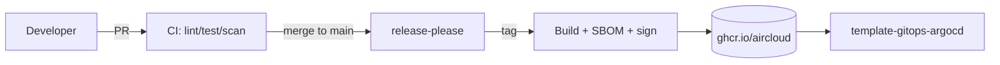
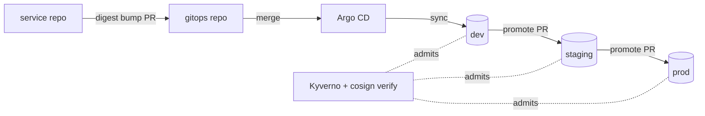

# Golden Paths

A **golden path** (a.k.a. paved road) is the supported, opinionated, well-lit way to build a
class of software at aircloud. Following the golden path means you inherit our CI/CD, security
baseline, observability, and AI-assistant config for free. You _may_ go off-road, but then you
own the maintenance and must still satisfy [`SECURITY-BASELINE.md`](./SECURITY-BASELINE.md).

> Org `aircloud`, registry `ghcr.io/aircloud`, and Azure prefix `aircloud` are example
> placeholders.

## Principles

1. **Start from a template.** Never hand-roll a new repo. Use the catalog.
2. **Boring by default.** Choose well-understood tools; novelty is a cost.
3. **Secure by default.** The baseline ships pre-wired; you opt _out_ deliberately, with sign-off.
4. **Automate the road.** Lint, format, test, scan, sign, release — all in CI, no manual steps.
5. **Same shape everywhere.** Every repo exposes the same `make`/`task` targets so humans and
   AI assistants behave consistently across stacks.

## Common contract (all golden paths)

Every template, regardless of stack, provides:

| Concern | Standard |
| --- | --- |
| Task runner | `Makefile` or `Taskfile.yml` with `setup lint format test build run security sbom clean` |
| Commits | [Conventional Commits](https://www.conventionalcommits.org), signed (verified) |
| Releases | [`release-please`](https://github.com/googleapis/release-please) + SemVer |
| CI | SHA-pinned actions, least-privilege `permissions`, `concurrency`, harden-runner |
| Supply chain | SBOM (Syft → CycloneDX), cosign keyless signing, SLSA build provenance |
| Scanning | Trivy, gitleaks, CodeQL and/or Semgrep, dependency-review, OpenSSF Scorecard |
| Cloud auth | GitHub OIDC + Azure federated credentials (no long-lived secrets) |
| AI config | `CLAUDE.md`, `AGENTS.md`, `.github/copilot-instructions.md`, `.cursor/rules/` |
| Dev env | `.devcontainer/`, `.editorconfig`, pre-commit hooks |
| Governance | `CODEOWNERS`, PR/issue templates, `SECURITY.md`, `CODE_OF_CONDUCT.md` |

---

## Backend

Templates: [`template-backend-typescript`](https://github.com/aircloud/template-backend-typescript),
[`template-backend-go`](https://github.com/aircloud/template-backend-go),
[`template-backend-python`](https://github.com/aircloud/template-backend-python).

**Choose:**

- **TypeScript** — product services, BFFs, anything where the team is JS-first. Fastify + Vitest.
- **Go** — high-throughput/low-latency services, Kubernetes controllers, CLIs. chi + testify.
- **Python** — data/ML-adjacent APIs, FastAPI services, integration glue. uv + ruff + pytest.

**You get:** multi-stage `Dockerfile` (distroless/chiseled, non-root `USER`, read-only rootfs
friendly, `HEALTHCHECK`), OpenTelemetry SDK wired to OTLP, structured JSON logging, health/readiness
probes, 12-factor config, and a `coverage` gate in CI.

**Containers** are built, scanned (Trivy + hadolint), SBOM'd, signed (cosign keyless), and pushed
to `ghcr.io/aircloud/<service>` with SLSA build provenance attestation.

## Frontend

Template: [`template-frontend-nextjs`](https://github.com/aircloud/template-frontend-nextjs).

**Choose it for:** web apps, internal dashboards, marketing sites. Next.js 15 (App Router),
React 19, TypeScript strict, Tailwind, Playwright E2E, Vitest unit, Storybook optional.

**You get:** ESLint + Prettier + `tsc --noEmit` in CI, Lighthouse CI budget, accessibility
checks (axe), a hardened CSP, and a distroless Node runtime image (or static export to a CDN).
Auth via the org IdP using OIDC/OAuth 2.1 with PKCE — no secrets in the browser bundle.

## Infrastructure as Code (IaC)

Template: [`template-terraform-azure`](https://github.com/aircloud/template-terraform-azure).

**Choose it for:** any Azure infrastructure. Terraform 1.9, remote state in Azure Storage with
state locking, OIDC auth (`azure/login` + federated credentials, **no client secrets**),
`tflint`, `checkov`, `terraform-docs`, and `infracost` on PRs.

**You get:** a `plan` on PR (posted as a comment), `apply` gated behind environment protection
rules and manual approval, drift detection on a schedule, and a module layout that matches the
Azure naming prefix `aircloud`. Provider versions are pinned; `terraform plan` artifacts are
signed and attested.

## GitOps

Template: [`template-gitops-argocd`](https://github.com/aircloud/template-gitops-argocd).

**Choose it for:** delivering apps to Kubernetes. Argo CD app-of-apps, Kustomize bases +
overlays per environment (`dev`/`staging`/`prod`), Helm for third-party charts, Kyverno admission
policies, and image-updater wired to verify cosign signatures before promotion.

**Promotion** is by PR: a successful build in a service repo opens a PR here bumping the image
digest; merging promotes through environments per
[`BRANCHING-AND-RELEASE.md`](./BRANCHING-AND-RELEASE.md). Only **signed** images with valid
SLSA provenance are admitted.

## Off-road requests

Need something the golden paths don't cover (a new language, a different cloud, a novel
datastore)? Open an RFC issue in this repo using the _Feature request_ template, tag
`@aircloud/platform`, and include the maintenance and security plan. If accepted, it becomes a
new golden path with its own template.
