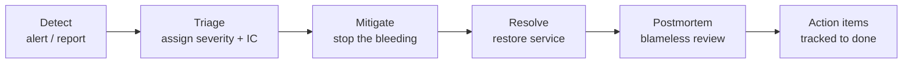

# Incident Response (Runbook)

This runbook describes how aircloud detects, responds to, and learns from incidents. It is the
canonical process; service teams may add service-specific runbooks but must not contradict it.

> Org `aircloud` is an example placeholder.

## Definitions

An **incident** is any unplanned event that degrades a service below its SLO, risks data, or
otherwise materially impacts customers or the business.

## Severity levels

| Sev | Definition | Examples | Response |
| --- | --- | --- | --- |
| **SEV1** | Critical: major outage or data breach | Tier-1 service down, confirmed data exfiltration | Page immediately, all-hands, exec + comms involved |
| **SEV2** | High: significant degradation | Elevated error rate breaching SLO, partial outage | Page on-call, IC assigned, status updates |
| **SEV3** | Moderate: limited impact | Single non-critical feature degraded | Business hours, ticket + owner |
| **SEV4** | Low: minor/no customer impact | Cosmetic bug, flaky non-blocking alert | Backlog |

A **security** incident (suspected breach, leaked secret, active exploit) is **always at least
SEV2** and immediately pulls in `@aircloud/security`.

## Roles

- **Incident Commander (IC)** — owns the response, makes decisions, not necessarily the most
  technical person. The first responder is IC until they hand off.
- **Operations/Tech Lead** — drives the technical investigation and mitigation.
- **Communications Lead** — owns internal/external updates and the status page (SEV1/SEV2).
- **Scribe** — keeps the timeline in the incident channel.

For small incidents one person may hold multiple roles; for SEV1 they are separate people.

## Lifecycle

### 1. Detect

Sources: SLO burn-rate alerts (see [`OBSERVABILITY.md`](./OBSERVABILITY.md)), synthetic
checks, customer reports, security tooling. Anyone can declare an incident.

### 2. Triage & declare

- Open an incident channel (`#inc-YYYYMMDD-<slug>`), assign **severity** and **IC**.
- Start the timeline (Scribe). Record every action with timestamps.
- For SEV1/SEV2, post an initial status within **15 minutes**.

### 3. Mitigate (stop the bleeding)

Prefer the fastest safe mitigation **before** root-causing:

- **Roll back** the last deploy (GitOps revert PR → Argo CD sync) — most outages are deploy-
  related.
- **Disable** the offending feature flag.
- **Scale out** or **shed load** (rate-limit) for saturation.
- **Rotate/revoke** credentials immediately for any secret exposure.

> The goal of mitigation is customer impact reduction, not a perfect fix.

### 4. Resolve

Confirm SLIs are back within SLO and stable. Downgrade severity as impact subsides. Close the
incident only when monitoring confirms recovery and any data integrity is verified.

### 5. Communicate

- **Internal:** updates in the incident channel at a cadence matching severity (SEV1: every
  30 min).
- **External:** Comms Lead updates the status page for customer-impacting SEV1/SEV2. Be honest,
  avoid speculation, give next-update times.

### 6. Blameless postmortem

Required for every SEV1/SEV2 (and any SEV3 with notable learnings) within **5 business days**.

Postmortem contents:

- **Summary** and customer impact (duration, scope, SLO budget burned).
- **Timeline** (detection → mitigation → resolution).
- **Root cause(s)** — use "5 whys"/contributing-factors; focus on systems, not people.
- **What went well / what went poorly / where we got lucky.**
- **Action items** — each with an owner and due date, tracked as issues to completion.

The culture is **blameless**: we fix systems, not assign blame. Hiding mistakes is the only
unacceptable behavior.

## Security incident specifics

For a suspected breach or leaked secret:

1. **Contain** — revoke/rotate affected credentials, isolate affected systems. Because cloud
   auth is OIDC, rotate federated trust / disable workflows rather than chasing static secrets.
2. **Preserve evidence** — snapshot logs and state before remediation where feasible.
3. **Notify** `@aircloud/security` and follow legal/regulatory notification timelines.
4. **Eradicate & recover** — remove the foothold, patch the vulnerability, restore from a known-
   good state.
5. Postmortem includes a control-gap analysis mapped to
   [`SECURITY-BASELINE.md`](./SECURITY-BASELINE.md).

## On-call expectations

- Acknowledge a page within **5 minutes**; if you can't, the escalation policy pages the next
  responder.
- Keep the runbook for your service current; a stale runbook is a defect.
- After your shift, hand off open items in the handover doc.

## Quick reference card

| Need | Do |
| --- | --- |
| Declare incident | Open `#inc-…`, set severity + IC, start timeline |
| Stop the bleeding | Roll back deploy / kill flag / scale / rotate creds |
| Status update | SEV1 every 30 min, SEV2 every 60 min |
| Secret leaked | Rotate/revoke now, page `@aircloud/security` |
| After resolution | Schedule blameless postmortem within 5 business days |
