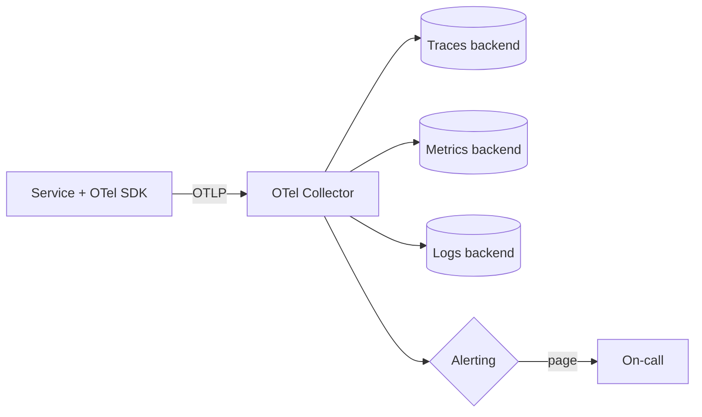

# Observability

aircloud standardizes on **OpenTelemetry (OTel)** for traces, metrics, and logs, and on
**SLOs** to define and defend reliability. If you can't measure it, you can't operate it.

> Org `aircloud` and Azure prefix `aircloud` are example placeholders.

## The three pillars + correlation

| Signal | Standard | Notes |
| --- | --- | --- |
| **Traces** | OTel SDK → OTLP → collector | Propagate W3C `traceparent`; one trace per request end-to-end. |
| **Metrics** | OTel metrics (RED/USE) | Exported via OTLP; Prometheus-compatible scrape allowed for infra. |
| **Logs** | Structured JSON, OTel log bridge | Include `trace_id`/`span_id` for correlation. |

Every log line, metric, and span carries a **correlation/trace ID** so an engineer can pivot
from an alert to the exact trace and logs.

## OpenTelemetry conventions

- **Instrument with the OTel SDK** for your language (auto-instrumentation for HTTP/DB/gRPC,
  manual spans for business logic). Templates ship this pre-wired.
- **Resource attributes** are mandatory: `service.name`, `service.version`,
  `service.namespace`, `deployment.environment` (`dev`/`staging`/`prod`).
- **Semantic conventions** — follow OTel semconv for span/attribute names; do not invent
  ad-hoc names where a standard one exists.
- **Export** via **OTLP** to the org **OpenTelemetry Collector**, which fans out to the
  backend (traces/metrics/logs). Apps never talk to vendor backends directly.
- **Sampling** — head-based parent sampling at the edge (e.g. 10% baseline), with tail-based
  sampling in the collector to always keep error/slow traces.



## What to measure: RED + USE

- **RED** (request-driven services): **R**ate, **E**rrors, **D**uration. The primary SLIs for
  APIs.
- **USE** (resources): **U**tilization, **S**aturation, **E**rrors. For queues, pools, CPU,
  memory, disk.

## SLIs, SLOs, and error budgets

- **SLI** — a measured ratio of good events to total events (e.g. fraction of requests served
  < 300 ms with a 2xx/3xx status).
- **SLO** — the target for an SLI over a rolling window (e.g. **99.9%** over 28 days).
- **Error budget** — `1 − SLO`. Spend it on shipping; when exhausted, freeze risky changes and
  prioritize reliability.

### Default SLO menu (tune per service)

| Service tier | Availability SLO | Latency SLO (p99) | Window |
| --- | --- | --- | --- |
| Tier 1 (customer-facing critical) | 99.95% | < 300 ms | 28 days |
| Tier 2 (customer-facing) | 99.9% | < 500 ms | 28 days |
| Tier 3 (internal) | 99.5% | < 1 s | 28 days |

Define SLOs in code/config (e.g. an `slo.yaml`) so they are reviewed and versioned. Alert on
**burn rate** (fast-burn page, slow-burn ticket), not on raw thresholds.

```yaml
# Example slo.yaml (per service)
service: checkout-api
tier: 1
objectives:
  - name: availability
    sli: "sum(rate(http_requests_total{code!~'5..'}[5m])) / sum(rate(http_requests_total[5m]))"
    target: 0.9995
    window: 28d
  - name: latency-p99
    sli: "histogram_quantile(0.99, sum(rate(http_request_duration_seconds_bucket[5m])) by (le))"
    target_seconds: 0.3
    window: 28d
alerting:
  burn_rate:
    fast: { multiplier: 14.4, window: 1h, action: page }
    slow: { multiplier: 6,    window: 6h, action: ticket }
```

## Dashboards & alerting

- Every service ships a **golden-signals dashboard** (rate/errors/latency + saturation),
  versioned as code next to the service.
- Alerts are **actionable** and link to a runbook. No alert without a runbook. Page only on
  symptoms that need a human now; everything else is a ticket.
- Synthetic checks (uptime probes) for Tier 1/2 endpoints.

## Cost & cardinality discipline

- Watch **label/attribute cardinality** — high-cardinality labels (user IDs, raw URLs) blow up
  metrics cost. Use exemplars/traces for high-cardinality detail.
- Set retention per signal (e.g. traces 7–14 days, metrics 13 months for capacity planning).

## Definition of "observable" (gate for launch)

- [ ] OTel SDK wired; traces/metrics/logs exported via OTLP with required resource attributes.
- [ ] Logs are structured JSON and carry `trace_id`.
- [ ] Golden-signals dashboard exists and is in version control.
- [ ] SLOs defined with burn-rate alerts that link to runbooks.
- [ ] Health (`/healthz`) and readiness (`/readyz`) endpoints implemented.

See [`INCIDENT-RESPONSE.md`](./INCIDENT-RESPONSE.md) for what happens when an SLO is breached.
