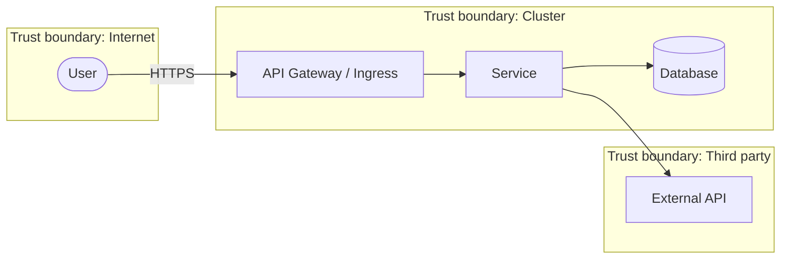

# Threat Model Template (STRIDE)

Copy this template into `docs/THREAT-MODEL.md` in your service repo and fill it in. Threat
modeling is required for any service that handles customer data, authenticates users, or is
internet-reachable, and must be revisited when the architecture materially changes.

> Org `aircloud` is an example placeholder.

## How to use

1. Draw the system as a data-flow diagram (DFD) with **trust boundaries**.
2. Enumerate threats per element using **STRIDE**.
3. Rate each threat, assign a mitigation and an owner, and link to a tracking issue.
4. Review with `@aircloud/security` before launch.

---

## 1. System overview

- **Service:** `<name>` — `<one-line purpose>`
- **Owners:** `@aircloud/<team>`
- **Data classification (highest handled):** `<Public | Internal | Confidential | Restricted>`
- **Internet-reachable:** `<yes/no>` · **Handles PII:** `<yes/no>` · **AuthN/Z:** `<scheme>`

## 2. Data classification

| Class | Definition | Examples | Handling requirements |
| --- | --- | --- | --- |
| **Public** | Intended for public release | Marketing copy, docs | No special handling |
| **Internal** | Default for business data | Internal metrics, runbooks | Access control; no public exposure |
| **Confidential** | Sensitive business/personal data | PII, customer records, tokens | Encryption in transit + at rest; least privilege; audit logging |
| **Restricted** | Highest sensitivity | Secrets, payment data, health data | All of Confidential + segregation, DLP, explicit access reviews, encryption with managed keys |

List the data this service stores/processes and its class:

| Data element | Class | At rest | In transit | Retention |
| --- | --- | --- | --- | --- |
| `<e.g. user email>` | Confidential | AES-256 (Azure SSE) | TLS 1.3 | `<period>` |

## 3. Data-flow diagram

## 4. STRIDE analysis

For each element/flow, identify threats. Replace the example rows.

| ID | Element / flow | STRIDE | Threat | Likelihood | Impact | Mitigation | Owner | Issue |
| --- | --- | --- | --- | --- | --- | --- | --- | --- |
| T1 | User → Ingress | **S**poofing | Attacker forges a session | Med | High | OIDC + short-lived tokens, MFA at IdP | `@team` | #123 |
| T2 | Service → DB | **T**ampering | SQL/NoSQL injection alters data | Med | High | Parameterized queries, input validation, least-priv DB user | `@team` | #124 |
| T3 | Service logs | **R**epudiation | Actions not attributable | Low | Med | Structured audit logs with actor + correlation ID | `@team` | #125 |
| T4 | DB at rest | **I**nformation disclosure | Data exposed if disk/backup leaked | Low | High | Encryption at rest, restricted backups, key rotation | `@team` | #126 |
| T5 | Ingress | **D**enial of service | Flood exhausts capacity | Med | Med | Rate limiting, autoscaling, WAF, timeouts | `@team` | #127 |
| T6 | Service → External API | **E**levation of privilege | Over-scoped token grants extra access | Low | High | Least-privilege scopes, per-call authz checks | `@team` | #128 |

### STRIDE quick reference

| Threat | Property violated | Typical mitigations |
| --- | --- | --- |
| **S**poofing | Authentication | Strong auth (OIDC/MFA), mutual TLS |
| **T**ampering | Integrity | Input validation, signing, integrity checks |
| **R**epudiation | Non-repudiation | Audit logging, signed actions |
| **I**nformation disclosure | Confidentiality | Encryption, access control, minimization |
| **D**enial of service | Availability | Rate limiting, quotas, autoscaling, timeouts |
| **E**levation of privilege | Authorization | Least privilege, authz checks, sandboxing |

## 5. Assumptions & out of scope

- Trusted: the cluster control plane, the IdP, the cloud provider's substrate.
- Out of scope: physical security of the cloud DC (provider responsibility).
- Document any assumption that, if false, would invalidate a mitigation.

## 6. Residual risk & sign-off

| Risk | Residual rating | Accepted by | Date | Review-by |
| --- | --- | --- | --- | --- |
| `<e.g. DoS beyond autoscale ceiling>` | Low | `@aircloud/security` | `<date>` | `<date + 6mo>` |

## 7. Action items

Track every unmitigated threat as an issue labeled `threat-model` with an owner and due date.
Re-run this model at least annually and on any material architecture change.
